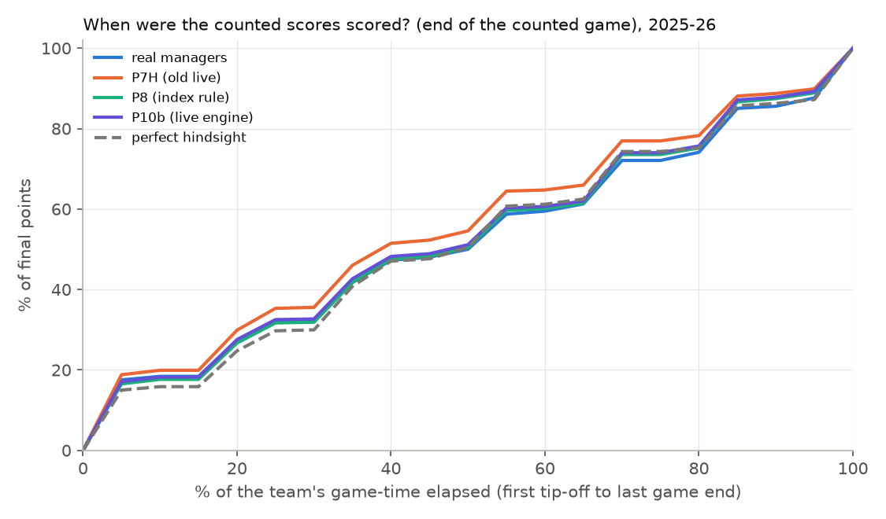
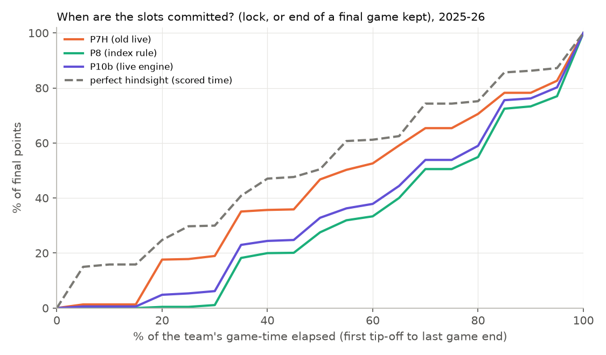

# Analysis H: how the lineup fills, where the points go, and what to try next (overnight 2026-10-15)

Research and analysis only: **no engine behaviour was changed** and nothing was shipped. The engine examined is the live
decision engine **P10b**, as wired in `lib/live/engine.ts`, with the old live engine **P7H_LheldTie** (labelled P7H
below), the index rule **P8**, the real managers and perfect hindsight for comparison. Data: the real 2025-26 season
(our league), the real 2024-25 season (synthetic league A), and model scenarios.

## Key findings
1. **We are not locking too early.** The scores our engines count come from games spread over the week almost exactly
   like perfect hindsight's: 33% / 51% / 74% of P10b's final points were already scored at 25 / 50 / 75% of the week's
   game-time, vs 30 / 50 / 74% for hindsight. In 2024-25 the engines run 2–6 points of share ahead of hindsight: they
   settle slightly earlier, as optimal stopping must, since they can't know a later game will be better.
   - The engines differ only in *when they commit*. P10b commits a score on average 25 h after its game ends (P8 28 h,
     P7H 17 h). By mid-week P10b has committed 33% of its final points (P8 28%, P7H 47%).
2. **"All 9 slots secured" always happens on the last day.** For every agent, hindsight included, the median is at
   98–100% of game-time, on a Sunday 61–88% of the time: one slot almost always holds a final-day game.
   - The informative measure is how many slots stay open. At the first tip-off of game day 5, P10b still has 5.9 open
     slots holding 177 of its final points (P7H 4.7 / 133, managers 4.7 / 82, hindsight 3.4 / 121).
   - Late-week flexibility *is* used: 2.6 slots and 69 pts are still open at the start of the last game day.
3. **Flexible slots are filled late only by P7H.** P7H commits G / F / UTIL at 65–81% of game-time vs 48–51% for PG / SF / C,
   by design. P10b and P8 commit all slot types late (64–84%) with equal values.
   - The Lagrangian prices agree that position eligibility hardly binds: every slot type has the same shadow value,
     ≈ 25.4 pts/wk. The scarce resource is the *number* of slots, not positions.
4. **Real managers lose mostly to empty slots, not to bad timing.** 20% of the managers' slots end the week empty or at 0
   (engines 1.3–2.6%). Their UTIL slot averages 17.9 pts vs ~31 for the engines.
   - Managers differ significantly in activity (ANOVA on empty slots F = 2.8, on weekly totals F = 3.9) but not in how
     high a score must be before they lock (F = 1.4; everyone locks at ≈ +1.1 sd above the projection).
5. **Where P10b's points go vs the Lagrangian bound** (exact accounting, validated on model scenarios where the categories
   sum to the gap within 0.04 ± 0.70 pts). On the 120 real 2025-26 team-weeks the categories sum to 9.2 ± 1.5 pts/wk
   (on model scenarios 7.7 ± 2.1, vs Phase 3's measured gap of 8.4):
   - **final games held to week end** although their slot-time was worth more: 2.6 ± 1.1;
   - **holding scores that were later given up**: 2.0 ± 0.9;
   - **tonight's players sat because held scores filled their slots**: 1.75 ± 0.5;
   - start/sit (started a player the priced plan would sit): 1.5 ± 0.4;
   - let-go regret 0.6; low non-final locks 0.5; slot placement, empty slot-time and unforced sits together 0.2.
6. **Most of that gap is contention between holding and playing, which is where the bound is loose.** About 6.4 of the
   9.2 pts are path-wise conflicts between a held score and a new game for the same slot, which the fluid bound only
   respects on average.
   - Exact optima of medium random weeks (2–4 slots, 3–6 players) put the bound 3–5% above the true optimum, rising
     with contention (Phase 1's tiny weeks: 1.7%). Scaled up, that is as large as P10b's whole gap (Part 2.4).
   - Our best estimate is that **roughly half or more of the 8–9-pt "gap" is bound looseness**, not lost points.
7. **One-step search still leaves about 0.5 pt/wk on the table, almost all in locks.** Re-evaluating the race's best
   rejected candidate on 96 fresh scenarios (661 decisions in 120 weeks):
   - it would have gained **+0.66 ± 0.44 pts/wk** in total (2024-25: +0.81 ± 0.64);
   - "lock now" alternatives that the race scored 0.5–1.0 pt better are really worth **+0.22 ± 0.06** each, about 2.6
     per week (≈ +0.56 pts/wk);
   - "unseat" alternatives are worth −0.22 each.
   - The race suffers a clear winner's curse: a race gain of +0.70 shrinks to +0.22 on fresh scenarios. Its 2-se rule
     still rejects too many of the lock-now moves.
8. **Information value is large and not recoverable.** E[perfect hindsight] − bound = 18.0 pts (model, 46 team-weeks). On
   the real season hindsight scores 320 vs P10b's 289. Most of the 31-pt difference is knowing the future, not policy.
9. **The win objective is capped by how few weeks are close.**
   - Against the real opponents P10b wins 67.8%. Only 6.5% of weeks are losses by < 10 pts and 6.5% are wins by < 10.
   - The oracle ceiling (every loss that our hindsight lineup would win) is +17 pp.
   - **P11's win probability is overconfident:** weeks it rates 0.65 / 0.84 at 3 game days left are won 47% / 65% of
     the time. Calibration is the cheapest P11 improvement.
10. **What to try next** (details at the end):
    1. **Lock-aware race acceptance with a fresh confirmation batch** (≈ +0.5 pt/wk expected; small effort);
    2. **a Lagrangian-penalized information-relaxation bound**, to settle how much of the 8–9 pts is real;
    3. **P8 hold/let-go priorities for final games and contested slots** (the top three categories);
    4. **one-player-at-a-time rollout** as P10b's candidate generator;
    5. **P(win) calibration + per-manager engagement prior** for P11.

---

## How the data was collected
- **Tracer** (`research/htrace.ts`, built to `research/dist/htrace.cjs`): runs a policy on one team-week through the invariant
  checker and records the physical lineup (who sits in which slot: in a game, holding, locked) after every event.
  - It uses the same runner and seeds as the season runs, so every total equals the published backtests exactly
    (checked on every team-week: P8 = `s9`, P7H_LheldTie = `s8`, P10b = `s10`).
  - P10b's race runs in a logging copy of `p10Hooks`, with identical decisions and random stream. It records every
    candidate's paired gain vs P8's decision. It also re-evaluates the best candidate *not* chosen against the chosen one
    on 96 fresh scenarios, on a separate random stream (`FRESH=96`, only when the race scored it > 0.25 pt better).
  - The research-only change to `research/invariants.ts` is two optional callbacks (`onStep`, `onEnd`). Default
    behaviour is unchanged. No file in `lib/` was touched.
- **Runs** (`research/h_pipeline.mjs`, `research/h_pipeline2.mjs`; ≤ 10 processes; outputs `research/out/h/<prefix>_<week>_<rid>.json`):

| prefix | season / data | policies | team-weeks |
|---|---|---|---|
| `r25` | 2025-26 real outcomes | P7H_LheldTie, P8, + perfect hindsight, + the real managers' lineups | 230 |
| `r25b` | 2025-26 real outcomes | **P10b** (live engine) with race logging | 120 (odd weeks × 10 teams) |
| `r24` | 2024-25 real outcomes, synthetic league A | P7H_LheldTie, P8, + hindsight | 230 |
| `r24b` | 2024-25, league A | P10b with race logging | 60 (weeks 2, 6, …, 22 × 10 teams) |
| `m8`, `m10` | model scenarios of the 46 gap-study team-weeks (seeds of `research/gap.ts`) | P8 × 100 scenarios, P10b × 1 scenario per team-week | 46 |
| `lagmed.jsonl` | random small weeks, exact optimum by brute force | bound vs optimum | 2–4 slots, 3–6 players |

- **Analysis:** `research/h_analyze.py` (Parts 1–2: `research/out/h/part1.md`, `part2.md`, charts) and `research/h_part4.py`
  (`part4.md`). Run with `python3 -E` (the shell's PYTHONPATH points at an incompatible numpy).
- **Definitions.**
  - **Secured / committed:** the time a slot's final counted score became fixed: the lock time, or, for a player's final
    game held to week end, the end of that game (the task's definition).
  - **Scored:** the end of the game that produced the counted score. For the real managers only this is known: the data
    holds the final lineup, not when they locked.
  - **Hindsight:** every player counts at most his best game, in distinct eligible slots; scored = committed.
  - **Game-time elapsed:** (t − the team's first tip-off) / (last game end − first tip-off).

## Part 1 — When does the lineup fill up?

### 1.1 Main table (2025-26 real outcomes, the 120 team-weeks P10b was traced on)
All columns use the same 120 team-weeks (odd weeks × 10 teams). For the full 230 the P7H / P8 / manager / hindsight
numbers are within 1–3 points of these (`research/out/h/part1.md`).

| | real managers | P7H | P8 | **P10b** | hindsight |
|---|---|---|---|---|---|
| mean total (pts/wk) | 235.3 | 287.1 | 287.5 | **289.0** | 320.1 |
| all 9 slots secured: % of game-time elapsed, p10 / p50 / p90 | 84 / 100 / 100 | 96 / 99 / 100 | 97 / 99 / 100 | 96 / 99 / 100 | 67 / 98 / 100 |
| all 9 secured: % of own games tipped off, p10 / p50 / p90 | 88 / 100 / 100 | 91 / 100 / 100 | 95 / 100 / 100 | 95 / 100 / 100 | 82 / 97 / 100 |
| all 9 secured: day of week | Sun 64%, Mon 25% | Sun 88%, Mon 8% | Sun 86%, Mon 13% | Sun 85%, Mon 12% | Sun 61%, Sat 18% |
| % of final points **already scored** at 25 / 50 / 75% of game-time | 32 / 50 / 72 | 35 / 55 / 77 | 32 / 50 / 74 | 33 / 51 / 74 | 30 / 50 / 74 |
| % of final points **committed** at 25 / 50 / 75% of game-time | (unknown)¹ | 18 / 47 / 65 | 0 / 28 / 51 | 5 / 33 / 54 | 30 / 50 / 74 |
| mean hours from the counted game's end to its commitment | (unknown)¹ | 16.6 | 28.2 | 24.6 | 0 |
| locks of a non-final game per week | 4.8 | 8.2 | 5.6 | 5.8 | — |
| … median hours from that game's end to the lock; share locked at the deadline (his next tip-off) | (unknown)¹ | 19.5 h; 6% | 45.5 h; 100% | 44.0 h; 70% | — |
| … the player's own later game beat the locked score (share of locks; shortfall pts/wk) | 20%; 7.9 | 15%; 9.1 | 17%; 7.2 | 16%; 7.2 | — |
| slots ending the week empty or at 0 | 20.0% | 1.3% | 2.6% | 1.9% | 0% |
| slots < 10 pts / negative | 2.1% / 0.3% | 2.3% / 0% | 2.6% / 0% | 2.4% / 0% | 0% / 0% |

¹ The managers' data is the final lineup only; their "secured" time is the end of the counted game (the earliest they
could have locked it).

**Open slots at the first tip-off of each game day** (number of slots not yet committed / their final points):

| game day | managers¹ | P7H | P8 | P10b | hindsight |
|---|---|---|---|---|---|
| 1 | 9.0 / 235 | 9.0 / 287 | 9.0 / 288 | 9.0 / 289 | 9.0 / 320 |
| 2 | 7.8 / 191 | 8.9 / 284 | 9.0 / 288 | 8.9 / 287 | 7.6 / 270 |
| 3 | 6.7 / 153 | 7.5 / 235 | 9.0 / 286 | 8.6 / 274 | 6.2 / 224 |
| 4 | 5.6 / 115 | 6.1 / 182 | 7.4 / 231 | 7.0 / 219 | 4.7 / 168 |
| 5 | 4.7 / 82 | 4.7 / 133 | 6.3 / 188 | 5.9 / 177 | 3.4 / 121 |
| 6 | 3.9 / 59 | 3.6 / 100 | 5.0 / 146 | 4.8 / 139 | 2.4 / 87 |
| 7 | 2.8 / 30 | 2.3 / 60 | 2.9 / 78 | 2.6 / 69 | 1.2 / 44 |

**Per slot type**: median commit time (% of game-time; managers and hindsight: scored time) / share committed by a lock
rather than a final game kept / mean counted points:

| slot | managers | P7H | P8 | P10b | hindsight |
|---|---|---|---|---|---|
| PG | 37% / 72% / 32.1 | 48% / 97% / 33.6 | 67% / 71% / 33.7 | 64% / 78% / 34.5 | 51% / – / 33.5 |
| SG | 34% / 82% / 28.0 | 50% / 93% / 31.2 | 66% / 67% / 31.0 | 66% / 72% / 30.6 | 50% / – / 33.8 |
| G | 60% / 62% / 25.3 | 65% / 90% / 30.5 | 81% / 68% / 32.0 | 81% / 65% / 32.4 | 50% / – / 36.2 |
| SF | 22% / 79% / 30.3 | 48% / 98% / 31.9 | 67% / 69% / 31.3 | 66% / 75% / 31.5 | 57% / – / 32.6 |
| PF | 35% / 77% / 30.5 | 51% / 92% / 31.0 | 79% / 72% / 32.0 | 65% / 71% / 33.2 | 50% / – / 34.6 |
| F | 53% / 61% / 21.9 | 66% / 92% / 32.6 | 79% / 69% / 31.3 | 80% / 70% / 31.0 | 35% / – / 35.6 |
| C | 34% / 74% / 31.3 | 49% / 94% / 33.1 | 79% / 61% / 34.4 | 65% / 69% / 34.1 | 50% / – / 36.2 |
| UTIL | 82% / 39% / 17.9 | 81% / 85% / 31.6 | 83% / 48% / 30.9 | 84% / 46% / 30.9 | 50% / – / 38.8 |

**2024-25 (league A, real outcomes)** shows the same pattern. Means: P7H 283.2, P8 285.4, hindsight 318.0 (230
team-weeks); on the 60 P10b team-weeks: P10b 288.5, P8 288.6, P7H 285.7, hindsight 320.6.
- Open slots at the start of game day 5: P7H 4.5, P8 6.0, hindsight 3.2.
- P7H locks 8.0 non-final games per week, P8 5.8; 18–19% of those locks are beaten by the player's own later game.

### 1.2 Charts
- `research/out/h/h_scored_curve_2025-26.png`: share of the final points whose game had already **ended**, vs
  game-time elapsed (all agents).
- `research/out/h/h_fill_curve_2025-26.png`: share of the final points **committed**, vs game-time elapsed (engines),
  with hindsight's scored curve as reference.
- The same two for 2024-25 (`…_2024-25.png`).




### 1.3 What it implies
- **No sign of locking too early.** If the engines locked too early, their counted scores would come from earlier games
  than hindsight's. They don't: in 2025-26 the "already scored" curves of P7H, P8 and P10b lie on top of hindsight's (within
  1–5 points of share at every quartile). In 2024-25 they run 2–9 points *ahead* of it, i.e. slightly earlier games.
  - What differs is commitment. P8 keeps every score uncommitted until the player's next tip-off (100% at the deadline,
    median 45 h after the game). P10b locks 30% of its locks earlier, when its race shows that a later tip-off would
    otherwise give the score up. P7H locks most scores within a day.
  - Ex post, 16–17% of P8 / P10b locks were beaten by the same player's later game (7.2 pts/wk of shortfall), vs 15%
    for P7H and 20% for the managers. That is the normal price of optimal stopping, not a timing bias.
- **Late-week flexibility is being used, not wasted.** P10b enters the final game day with 2.6 open slots worth 69 pts,
  more than hindsight needs (1.2 / 44) and far more than the managers (2.8 slots but only 30 pts: their open slots are
  mostly ones that end empty).
  - The cost of that flexibility shows up in Part 2: final games kept to week end and held scores later given up are
    the two largest categories.
- **"All 9 secured" is not a useful target.** It happens on the last day for every agent, perfect hindsight included,
  because the last slot to be secured is almost always a held final game. The useful quantity is the number of open
  slots per day (table above).
- **Flexible slots.** Only P7H fills G / F / UTIL systematically later (lockAware puts locks in narrow slots first). For
  P8 / P10b the slot type hardly matters: equal shadow prices (2.3), equal counted values, and placement costs ≈ 0 in
  Part 2. The managers are the opposite: UTIL is their leftover slot (17.9 pts, committed at 82% of game-time, only
  39% by a lock).
- **Managers vs engines.** The 52-pt gap between managers and P10b is mostly empty or zero slots (20% vs 1.9%), plus
  weaker G / F / UTIL slots. Their timing is like hindsight's because their scores are dated by the end of the counted
  game, the earliest possible lock.

## Part 2 — Where are the missing points?

### 2.1 Method: an exact accounting of the gap to the Lagrangian bound
The Phase-1 bound is bound(μ) = Σ_p V_p(μ) + Σ_{s,b} μ_sb, with the week-start optimal slot prices μ. For any policy and
any outcome path, with W the week total, W_p player p's counted points, C_p = Σ μ over the slot-time he actually occupied,
and o_sb ∈ {0,1} the physical occupancy of slot s in bucket b:

  **bound − W = Σ_p (V_p − W_p + C_p) + Σ_{s,b} μ_sb (1 − o_sb)**   (an identity on every path)

V_p − W_p + C_p is p's shortfall against his own priced single-player DP (exact, the same DP as the bound). By the
performance-difference lemma it splits, on every path, into:
- **decision losses:** at each of his decisions, (DP value of the best action − DP value of the action taken);
- **extra slot charges:** a pricier slot than the cheapest eligible one; locking before his next tip-off; holding a
  score that is later given up;
- **noise:** a zero-mean term (the luck of his own outcomes).

Every term except the noise is ≥ 0, so they rank cleanly.

**Validation on model scenarios.** The categories must add up to bound − E[W]:
- P8, 46 team-weeks × 100 scenarios: categories **10.18 ± 0.60**, gap 10.23 ± 1.04, noise **0.04 ± 0.70**;
- spot checks, 5 team-weeks × 400–1,000 scenarios: pooled noise −0.57 ± 0.45.

On real outcomes the noise also absorbs model miscalibration (the model runs ~5–7 pts optimistic), so there only the
categories are reported. They are the model's expected losses of the decisions actually taken.

Caveats:
- The categories measure deviations from the *week-start fluid plan*. Part of each is unavoidable: on a given path,
  capacity binds when the plan only respects it on average. That share is labelled **forced** where it can be seen
  directly: a player the plan would start sat because no eligible slot was free, or a score let go with no eligible slot
  free.
- The rest of the gap that is really "bound looseness" is estimated in 2.4.

### 2.2 The leak categories, ranked (pts/wk, 95% CI over team-weeks)
Real 2025-26 outcomes, on the same 120 team-weeks for all three engines. The model columns are the 46 gap-study
team-weeks: P8 averaged over 100 scenarios each, P10b over 1 scenario each (P10b is ~250 s per week).

| rank | leak (category in `part2.md`) | **P10b real** | P8 real | P7H real | P8 model | P10b model |
|---|---|---|---|---|---|---|
| 1 | **final game kept to week end although its slot-time was worth more** (`kept_should_go`, final game) | **2.58 ± 1.07** | n/a² | n/a² | n/a² | 1.82 ± 1.60 |
| 2 | **holding a score that is later given up** (`held_then_let_go`) | **2.03 ± 0.90** | 3.02 ± 1.13 | 1.12 ± 0.57 | 2.76 ± 0.31 | 0.91 ± 0.42 |
| 3 | **tonight's player sat, no eligible slot free** (`sit_should_start_forced`) | **1.84 ± 0.42** | 1.90 ± 0.49 | 2.26 ± 0.50 | 2.24 ± 0.21 | 2.43 ± 0.83 |
| | … of which the slots were filled by held scores ("holds that blocked a tipping player") | 1.75 ± 0.47 | | | | |
| | … by locks / by games and other starters | 0.25 / 0.08 | | | | |
| 4 | **start/sit: started a player the priced plan would sit** (`start_should_sit` + `_dnp`) | **1.54 ± 0.40** | 1.76 ± 0.50 | 1.58 ± 0.31 | 1.50 ± 0.17 | 1.04 ± 0.73 |
| | … of which the start was a DNP (injury/rest handling) | 0.41 ± 0.21 | 0.56 ± 0.28 | 0.47 ± 0.17 | 0.56 ± 0.11 | |
| 5 | let-go regret: a score above its threshold let go (`went_should_keep`) | 0.56 ± 0.26 | 0.59 ± 0.21 | 0.51 ± 0.23 | 1.04 ± 0.11 | 1.09 ± 0.65 |
| 6 | non-final score kept (locked) below its threshold ("locked too low") | 0.52 | (2.89 incl. final games) | (4.37 incl. final games) | (2.39 incl. final games) | |
| 7 | unforced sit: an eligible slot was free (`sit_should_start_free`) | 0.07 ± 0.05 | 0.01 | **1.61 ± 0.24** | 0.02 | |
| 8 | slot placement: wider/pricier slot, early lock (`place_*`, `lock_early`) | 0.08 | 0.10 | 0.13 | 0.11 | |
| 9 | empty priced slot-time (`empty`) | 0.03 ± 0.02 | 0.38 ± 0.46 | **0.92 ± 0.18** | 0.13 ± 0.04 | |
| | **total of the categories** | **9.24 ± 1.47** | 10.65 ± 1.63 | 12.50 ± 1.35 | 10.18 ± 0.60 | **7.66 ± 2.08** |
| | bound − W (model: bound − E[W]) | 12.6 ± 6.6 (noisy) | 14.1 ± 6.6 | 14.5 ± 6.3 | 10.23 ± 1.04 | -1.1 ± 9.9 (1 scenario per team-week: noisy; Phase 3: 8.4 on 5) |

² The final-game split was added to the tracer after these runs. The same split for 2024-25 is in `part2.md`.

Reading:
- **The three largest leaks are one phenomenon: a held score and a new game competing for the same slot.** Ranks 1–3
  add up to 6.4 of P10b's 9.2 pts. The relaxed plan resolves these conflicts fractionally ("hold with probability 0.6"),
  while a real policy must pick one side on every path. This is exactly where a fluid bound is loose. These categories
  are therefore *upper bounds* on what better holding decisions can win; 2.4 estimates how much is real.
- **P10b vs P8** (same weeks): P10b cuts held-then-let-go by 1.0 and empty slot-time by 0.35. It does this by locking
  earlier when a later tip-off would otherwise force the score out (Phase 3). On model scenarios the same cut is
  larger: held-then-let-go 2.76 → 0.91.
- **P7H's specific losses** are unforced sits (1.61) and empty slot-time (0.92): the holdYield / reserve rules sit
  players and leave slots idle that the prices say should be used. Its lower held-then-let-go (1.12) is the other side of
  locking early.
- **Small leaks:** slot placement (narrow vs wide slot, S_lock_wider) ≈ 0.1; early-lock price ≈ 0; empty slot-time ≈ 0
  for P10b; DNP starts 0.4.
- **2024-25 replicates** (`part2.md`): P7H 11.8 ± 0.9, P8 10.2 ± 1.1, with the same ordering. Held-then-let-go,
  kept-below-threshold and forced sits are again the top three for P8; P10b: on its 60 team-weeks the categories total 8.04 ± 1.50 (P8 9.75 ± 1.90, P7H 11.83 ± 1.58 on the same weeks); forced sits 2.02 ± 0.58 (of which blocked by held scores 1.68 ± 0.55), kept below threshold 2.44 ± 0.99 (final games 2.06 ± 0.99), held-then-let-go 1.12 ± 0.56, let-go regret 0.91 ± 0.45.

### 2.3 What the race sees: one-step improvement still available
For every P10b decision with ≥ 2 candidates (25.2 per week; 2.4 switched from P8 per week), the tracer logged every
candidate's paired gain vs P8's decision. When the best candidate *not* chosen was more than 0.25 pt ahead in the race
(5.5 decisions per week), it was re-evaluated against the chosen decision on 96 fresh scenarios. This is an unbiased
estimate of what switching to it would gain, with P8 playing the rest of the week.

| race gain of the rejected runner-up | decisions per week | its race gain | **fresh re-evaluation** | gain per week if always switched |
|---|---|---|---|---|
| 0.25–0.5 | 2.19 | +0.37 | +0.04 ± 0.05 | +0.09 |
| 0.5–1.0 | 2.56 | +0.70 | **+0.22 ± 0.06** | **+0.56** |
| 1.0–2.0 (failed the 2-se test) | 0.73 | +1.22 | +0.05 ± 0.13 | +0.04 |
| > 2 | 0.03 | +3.02 | −1.05 ± 0.72 | −0.03 |
| **all** | 5.51 | +0.65 | +0.12 | **+0.66 ± 0.44** (95% CI over team-weeks) |

By the runner-up's kind (fresh mean per decision): **lock** +0.17 (516 decisions, 4.3/wk); **out** (unseat a player)
−0.22 (101); **in** (seat a player) +0.29 (38).

**2024-25 replicates** (60 team-weeks, `r24b`). Rejected runner-ups are worth **+0.81 ± 0.64 pts/wk** on fresh
scenarios; **lock** alternatives +0.18 each (256 decisions, 4.3/wk), **out** −0.06. By race-gain bin:
- 0.25–0.5: +0.11 ± 0.07;
- 0.5–1.0: +0.11 ± 0.09;
- 1.0–2.0: +0.44 ± 0.16.

The bins differ between seasons, but in both the gain is concentrated in "lock now" alternatives, at about +0.17–0.18
per decision and 4–5 decisions per week.
- **Winner's curse, measured.** Race gains shrink by roughly 70% on fresh scenarios (+0.70 → +0.22). The 2-se switch rule
  is therefore right to be cautious about *large* claimed gains: those don't hold up (+1.22 → +0.05).
- **But it rejects a steady stream of small, real "lock now" gains** (+0.17 to +0.22 each, 4–5 per week). That is where
  the remaining one-step value is: about +0.5 pt/wk under the model, all of it in locks.
- **The rest of the gap is not visible to one-step search** over P10b's candidates. Of the 9 pts, at most ~0.7 is
  recoverable by switching to the race's own runner-up. The remainder is multi-step (the continuation policy P8 is
  itself ~10 pts from the bound), candidates never generated, or bound looseness.

### 2.4 How much of the gap is bound looseness? (part c)
1. **Exact optimum vs bound on medium random weeks** (`research/h_lagmed.ts`; brute force; discrete 3-valued scores, DNP
   chain, 2–3 games per player over 4 days):

| slots × players | weeks | E[optimum] | Lagrangian bound | bound − optimum | relative | E[hindsight] | share of the information gap (bound − opt) / (hindsight − opt) |
|---|---|---|---|---|---|---|---|
| 1–2 × 2–3 (Phase 1, `lagtiny`) | 300 | 24.86 | 25.29 | +0.43 | 1.7% | 27.11 | 0.19 |
| 2 × 3 | 200 | 42.85 | 44.25 | +1.40 | 3.2% | 47.26 | 0.32 |
| 2 × 4 | 150 | 49.39 | 51.20 | +1.81 | 3.6% | 54.66 | 0.34 |
| 2 × 5 | 100 | 52.34 | 54.28 | +1.94 | 3.7% | 58.03 | 0.34 |
| 3 × 4 | 100 | 64.94 | 67.17 | +2.23 | 3.4% | 71.44 | 0.34 |
| 3 × 5 | 100 | 71.85 | 74.72 | +2.87 | 4.0% | 79.15 | 0.39 |
| 3 × 6 | 24 | 77.83 | 81.42 | +3.59 | 4.6% | 85.60 | 0.46 |
| 4 × 6 | 24 | 94.14 | 97.69 | +3.56 | 3.7% | 103.08 | 0.40 |

(A 4 × 7 run was stopped after 16 minutes for time; the bound was never below the optimum.)

   - **The bound's excess over the true optimum grows with contention**: from 1.7% on Phase 1's tiny weeks to 3–5% here.
     It is about a third to a half of the information gap (hindsight − optimum).
   - **Scaled to a real week, both ways overshoot.**
     - Relative scaling: 3–5% of ~290 pts = 9–13 pts.
     - Information-gap scaling: with hindsight − bound = 18.0 on the model weeks, a 0.32–0.46 share means bound −
       optimum ≈ 8.5–15 pts.
     - Both are as large as P10b's entire 8.4–9-pt gap or larger. Since the optimum is at least P10b's value, real weeks
       must be relatively *less* loose than these random ones: more slots pool better, and real scores are less extreme.
   - **The direction is still clear: a large part of the gap, plausibly most of it, is looseness of the bound.** Treat
     this as an indication, not a measurement. Item A of Part 3 (an information-relaxation bound) would measure it.
2. **The categories point the same way.** 6.4 of the 9.2 pts are the hold-vs-play contention categories, where a fluid
   bound is loose by construction. The categories with no contention component (start/sit of uncontested players,
   placement, empty time) are small (≈ 1.7 pts).
3. **Search finds little.** A one-step re-evaluation recovers ≈ 0.5–0.7 pts/wk (2.3). Phase 2–3's progression shows
   diminishing returns: P8 → P10b +2.3 real, while the bound gap went 10 → 8.4.
4. **Information relaxations are the standard tool to settle this.** Brown, Smith & Sun 2010, with penalties from our
   per-player Lagrangian values (Part 3, item A). It is the first thing to build if the remaining gap is to be chased.

**Best estimate:** of P10b's ~8.4–9 pts below the Lagrangian bound, roughly 1–3 pts look recoverable by better policies
(≈ 0.5 by lock-aware acceptance, ≈ 0.5–1.5 by better hold/let-go priorities, the rest uncertain). The other ~5–7 pts are
probably bound looseness. Information value (hindsight − bound) is a further 18 pts that no policy can recover.

### 2.5 Where capacity binds: the Lagrangian prices
- **Shadow value of one more slot for the week:** 25.4–25.6 pts for every slot type (2025-26; 2024-25: 23.7–24.5). Equal
  shadow values mean the relaxed problem never runs short of a *position*, only of slots. That is why placement
  categories are ≈ 0.
- **When the prices bind** (price mass by ET day, all slots, 2025-26): Mon 1.0, Tue 1.2, Wed 4.3, Thu 4.7, Fri 8.5,
  Sat 15.4, Sun 193.9 pts.
  - The Sunday mass is the "a kept score occupies a slot until week end" price, the cost of every lock and every
    final-game hold. The prices are degenerate here: any price on the last bucket charges all keepers alike.
  - The mid-week mass (Wed–Sat, ≈ 33 pts) marks the nights when in-game and holding demand exceeds the 9 slots: Friday
    and Saturday slates. Those are the moments where the hold-vs-play conflicts of 2.2 happen.

## Part 3 — Literature and algorithm ideas

Full annotated review with ~85 citations, links and a verification log: `research/out/h/literature.md`. Every citation below
was checked against a publisher, arXiv or author page (or, where marked there, only through citing works). No academic
work on Lock-In-style score-locking formats was found; the closest formal models are multiple-exercise ("swing") options
with refraction periods and prophet inequalities over time.

### 3.1 Where our engine sits in the literature
| family | key references | how it maps onto Lock-In | what it says about us |
|---|---|---|---|
| Weakly coupled MDPs, Lagrangian / fluid relaxations | Hawkins 2003 ([thesis](https://dspace.mit.edu/handle/1721.1/29599)); Adelman & Mersereau 2008 ([OR](https://pubsonline.informs.org/doi/10.1287/opre.1070.0445)); Brown & Zhang 2023 ([OR](https://pubsonline.informs.org/doi/10.1287/opre.2022.2287)) | players = sub-problems, slots × time buckets = linking constraints; our bound and P8 are exactly Hawkins' construction | Brown & Zhang: the ALP bound is no tighter than the Lagrangian one when the linking constraints are state-independent and (near-)unimodular — ours nearly are. **A tighter bound must come from information relaxations or history-dependent prices, not from an ALP.** |
| Re-solving / index policies | Brown & Smith 2020 ([Mgmt Sci](https://jimsmith.host.dartmouth.edu/wp-content/uploads/2022/04/Dynamic-Selection-Problems.pdf)); Bumpensanti & Wang 2020 ([Mgmt Sci](https://arxiv.org/abs/1802.06192)); Gast, Gaujal & Yan 2024 ([MOR](https://arxiv.org/abs/2106.10067)); Zhang & Frazier 2021 ([arXiv](https://arxiv.org/abs/2107.11911)); Brown & Zhang 2022 ([OR](https://pubsonline.informs.org/doi/10.1287/opre.2021.2181)) | P8 = LP-update / re-solved Lagrangian index policy | re-solving is right (our +2 pts P8 − P8f replicates this); tie-breaking among near-zero priced advantages matters (Brown & Smith); acting on confident fluid decisions and treating fractional ones specially (Bumpensanti & Wang) = "race only the contested decisions" |
| Rollout / approximate policy iteration | Bertsekas, Tsitsiklis & Wu 1997 ([J. Heuristics](https://www.mit.edu/~jnt/Papers/J066-97-rollout.pdf)); Bertsekas 2019/2020 multiagent and constrained rollout ([arXiv 1910.00120](https://arxiv.org/abs/1910.00120), [arXiv 2002.07407](https://arxiv.org/abs/2002.07407)); Rusmevichientong, Sumida & Topaloglu 2020 ([Mgmt Sci](https://pubsonline.informs.org/doi/abs/10.1287/mnsc.2019.3346)); Goodson, Thomas & Ohlmann 2017 ([EJOR](https://ideas.repec.org/a/eee/ejores/v258y2017i1p216-229.html)) | P10b = one-step rollout of P8 over ~8 candidate joint decisions | the closest published analogue of P10b (rollout of a decomposed policy for reusable resources) is near-optimal in its experiments; one-agent-at-a-time rollout explores joint decisions at linear cost |
| Ranking & selection, optimizer's curse | Kim & Nelson 2001 ([TOMACS](https://www.cs.utexas.edu/~shivaram/readings/b2hd-KimNelson2001.html)); Nelson & Matejcik 1995 ([Mgmt Sci](https://pubsonline.informs.org/doi/10.1287/mnsc.41.12.1935)); Chen et al. 2000 OCBA ([DEDS](https://www.doi.org/10.1023/A:1008349927281)); Smith & Winkler 2006 ([Mgmt Sci](https://pubsonline.informs.org/doi/10.1287/mnsc.1050.0451)) | the race (successive halving with CRN, switch if > 0.5 pt and > 2 se) | selection on the same scenarios inflates the winner's gain; a fresh confirmation batch removes the bias (measured in Part 2) |
| Information relaxation duality | Brown, Smith & Sun 2010 ([OR](https://jimsmith.host.dartmouth.edu/wp-content/uploads/2022/04/Information_Relaxations_and_Duality_in_Stochastic_Dynamic_Programs.pdf)); Brown & Smith 2014 ([OR](https://jimsmith.host.dartmouth.edu/wp-content/uploads/2022/04/Information_Relaxations_and_Convexity.pdf)); Ye, Zhu & Zhou 2014 ([arXiv](https://arxiv.org/abs/1405.3363)); Balseiro & Brown 2019 ([OR](https://pubsonline.informs.org/doi/10.1287/opre.2018.1782)); Brown & Smith 2022 tutorial ([FnT](https://nowpublishers.com/article/Details/OPT-027)) | perfect hindsight (317.5 real, ~320 model) is the zero-penalty dual bound; a penalty built from the per-player Lagrangian values keeps the inner problem a deterministic weekly assignment | the standard way to **measure how much of the 8.4-pt bound gap is real** (Part 2(c) suggests most of it may be bound looseness) |
| Multiple stopping with refraction | Meinshausen & Hambly 2004 ([Math. Finance](https://stat.ethz.ch/sfs-reports/111.html)); Bender, Schoenmakers & Zhang 2015 ([arXiv](https://arxiv.org/abs/1112.2638)); Abels, Pitschmann & Schmand 2023 ([EC/arXiv](https://arxiv.org/abs/2211.10471)) | a team = up to 9 "exercises" (locks), each consuming a slot; games block slots for 2.5 h | a second, independent route to dual bounds; conceptual |
| Prophet inequalities / online matching with reusable resources | Kleinberg & Weinberg 2012 ([arXiv](https://arxiv.org/abs/1201.4764)); Baek & Ma 2019 ([arXiv](https://arxiv.org/abs/1906.04899)); Dickerson et al. 2018 ([arXiv](https://arxiv.org/abs/1711.08345)); Feng, Niazadeh & Saberi 2024 ([OR](https://arxiv.org/abs/2512.06997)); Jiang, Ma & Zhang 2025 ([OR](https://arxiv.org/abs/2107.02058)) | price/threshold policies with constant-factor guarantees; our constraint = position matroid × interval overlap (Baek & Ma's setting) | guarantees (≈ 1/2) are far below what we already achieve; "LP + online contention resolution" is an alternative to P8's argmax, low priority |
| Hindsight optimization / SAA | Chang, Givan & Chong 2004 ([DEDS](https://scholarworks.sogang.ac.kr/item/9f189e84-3bda-4a83-af8c-e43b21120ce1)); Bent & Van Hentenryck 2004 ([AAAI](https://cdn.aaai.org/AAAI/2004/AAAI04-080.pdf)); Yoon et al. 2008 ([AAAI](https://mlanthology.org/aaai/2008/yoon2008aaai-probabilistic)); Vera & Banerjee 2021 ([Mgmt Sci](https://pubsonline.informs.org/doi/10.1287/mnsc.2020.3624)); Kleywegt, Shapiro & Homem-de-Mello 2002 ([SIOPT](https://edoc.hu-berlin.de/18452/8871)) | value an action by the mean of hindsight-optimal continuations; "consensus" = action most often in scenario optima | cheap candidate generator (our hindsight solver is one assignment); as a scorer it over-values waiting (anticipation bias) unless penalized |
| MCTS | Browne et al. 2012 ([IEEE TCIAIG](https://ieeexplore.ieee.org/document/6145622)); Kocsis & Szepesvári 2006 ([ECML](https://mlanthology.org/ecmlpkdd/2006/kocsis2006ecml-bandit)); Couëtoux et al. 2011 (double progressive widening) | depth-2 tree (tonight × next tip-off) with P8 leaves | without a learned value it reduces to rollout + racing; 5–20× P10b cost; only worth it if depth-2 changes depth-1 rankings often |
| RL for combinatorial assignment | Alomrani, Moravej & Khalil 2022 ([TMLR/arXiv](https://arxiv.org/abs/2109.10380)); Kong et al. 2019 ([ICLR](https://mlanthology.org/iclr/2019/kong2019iclr-new/)); Kool et al. 2019 ([ICLR/arXiv](https://arxiv.org/abs/1803.08475)) | learned policies beat greedy by 3–10% in online matching | our base is already within ~3% of the bound; realistic use = a learned value function for truncated rollouts |
| Fantasy sports | Hunter, Vielma & Zaman 2016 ([arXiv](https://arxiv.org/abs/1604.01455)); Haugh & Singal 2021 ([Mgmt Sci](https://papers.ssrn.com/abstract=3393127)); Becker & Sun 2016 ([JQAS](https://ideas.repec.org/a/bpj/jqsprt/v12y2016i1p17-30n1.html)) | DFS lineups (one-shot) with variance seeking and explicit opponent models | Haugh & Singal's opponent modelling (Dirichlet regression of opponents' choices) is the closest analogue of our human opponent model |
| Risk-sensitive / target objectives; contests | Bäuerle & Rieder 2014 ([MOR](https://publikationen.bibliothek.kit.edu/1000039663)); Chow et al. 2015 ([NeurIPS](https://proceedings.neurips.cc/paper/2015/hash/64223ccf70bbb65a3a4aceac37e21016-Abstract.html)); Gaba, Tsetlin & Winkler 2004 ([OR](https://pubsonline.informs.org/doi/10.1287/opre.1030.0098)); Anderson & Cabral 2007 (RAND J. Econ.); Shapley 1953 ([PNAS](https://doi.org/10.1073/pnas.39.10.1095)) | P(total > opponent) is an MDP once accumulated points are in the state; favourite reduces variance, underdog increases it | P11's T + β·F_opp(T) is the standard practical approximation; a game-theoretic solution is not worth it against humans who do not react to us in real time |

### 3.2 The methods worth trying, mapped onto Part 2's gap categories
| method | gap category it attacks (Part 2) | expected gain (our estimate) | live compute (12 workers, 9-min watchdog) | effort |
|---|---|---|---|---|
| **A. Lagrangian-penalized information-relaxation bound** (BSS 2010, Ye-Zhu-Zhou) | bound looseness — tells us how much of the 8.4 pts is real | 0 directly; decides whether B–E are worth pursuing | offline only (one penalized hindsight assignment per scenario) | M |
| **B. Winner's-curse-free race** (fresh confirmation batch; KN/OCBA allocation) | race noise; Part 2's runner-up re-evaluation | +0.1 to +0.4 pts/wk, fewer bad switches | +1 batch (16–64 scenarios) on switching decisions only | S |
| **C. One-player-at-a-time (multiagent) rollout** as candidate generator | joint decisions outside P10b's 8 candidates (start/sit × hold/lock coupling) | +0.2 to +1.0 | 1–3× P10b per decision; fits with the worker pool | M |
| **D. Truncated rollouts + terminal value + control variates** | race noise → more candidates / depth-2 at lock decisions in the same time | +0.2 to +1.0 | ≤ P10b | M |
| **E. P8 base upgrades** (tie-breaks among near-zero advantages, thresholded re-solve, parallel rollout over several bases) | the "base policy" share of the gap (held-then-let-go, kept-below-threshold, forced sits) | +0.2 to +1.0 on P8, roughly half on P10b | none | S |
| F. Hindsight-consensus candidates | candidate generation | 0 to +0.5 | one assignment per scenario | S |
| G. Depth-2 MCTS at high-stakes tip-offs | multi-step lookahead | unknown; measure rank changes first | 5–20× | L |
| H. Learned value function (RL) | lookahead, pruning | unknown | ms per call after training | L |

Not recommended: ALP bound (Brown & Zhang: no tighter here), SDDP / progressive hedging (integer recourse, latency),
end-to-end RL policies (large effort, small expected margin over a near-bound base), exact target-probability DP (breaks
the per-player decomposition).

## Part 4 — The win-probability objective (P11 follow-ups)

Data: 2025-26 league history (10 managers × 23 weeks, final lineups matched to games), the P10 / P10b season runs against
the real opponents (`s10`), and P11's win-phase logs on the real season (`p11/a25m`). Tables: `research/out/h/part4.md`
(script `research/h_part4.py`).

### 4.1 How much is there to win?
| P10b vs the real opponents (214 team-weeks with an opponent) | count | share of weeks |
|---|---|---|
| wins | 145 | 67.8% |
| losses | 67 | 31.3% |
| … losses that even perfect hindsight on our side would lose ("unwinnable") | 30 | 14.0% |
| … **winnable losses** (our hindsight total beats his actual score) | 37 | **17.3%** = oracle ceiling |
| … losses by < 5 / < 10 / < 20 pts | 6 / 14 / 23 | 2.8% / 6.5% / 10.7% |
| wins by < 5 / < 10 / < 20 pts (could be lost by riskier play) | 6 / 14 / 24 | 2.8% / 6.5% / 11.2% |

- The **absolute ceiling** for any change to our own decisions is +17 pp (every winnable loss flipped, no win lost). That
  needs perfect foresight of our own players.
- **The realistic pool is the close weeks**: 14 losses and 14 wins within 10 pts (6.5% each). A risk dial can only
  trade between these two pools. P11's measured +0.5–1 pp is roughly 1 flipped week per 100.
- The matchup median margin is +30 pts; p10 / p90 = −40 / +152. Most weeks are not close.

### 4.2 When is the matchup decided? (P11's own win probability at 3 game days left, real season)
- At the first win-phase decision: P(win) < 0.25 in 1% of weeks, 0.25–0.75 in 30%, 0.75–0.95 in 54%, ≥ 0.95 in 14%.
  Between the first and last win-phase decision, P(win) moves by 0.22 on average.
- **The model is overconfident.** Calibration of that P(win) against the actual result:

| predicted P(win), 3 game days left | weeks | mean predicted | realized |
|---|---|---|---|
| < 0.50 | 15 | 0.35 | 0.20 |
| 0.50–0.75 | 52 | 0.65 | 0.47 |
| 0.75–0.90 | 68 | 0.84 | 0.65 |
| 0.90–0.97 | 61 | 0.93 | 0.92 |
| ≥ 0.97 | 18 | 0.98 | 1.00 |

  In the middle bins, where the win objective acts, realized win rates are **15–20 pp below** predicted. Two known causes
  add up: our own model runs ~5–7 pts optimistic (REPORT, Phase 2/3), and real opponents still score a few points more,
  with more spread, than the human model (Phase 5 PIT table). With an overconfident P(win), P11 thinks it is a
  favourite when the week is a coin flip, so its dial leans risk-averse too often.

### 4.3 How the managers play (per-manager behaviour)
| roster | mean total | sd | weeks < 150 | zero / empty slots per week | counted slots from the player's final game | mean z of locked scores | P8 − manager |
|---|---|---|---|---|---|---|---|
| 1 | 224.4 | 74.7 | 6 | 2.39 | 22% | +1.24 | +38.2 |
| 2 | 268.7 | 78.1 | 2 | 1.09 | 32% | +1.22 | +31.4 |
| 3 | 261.1 | 67.8 | 2 | 0.83 | 41% | +1.16 | +29.3 |
| 4 | 179.3 | 61.0 | 9 | 2.61 | 41% | +1.11 | +87.4 |
| 5 | 212.5 | 63.6 | 5 | 2.22 | 39% | +1.03 | +62.8 |
| 6 | 234.7 | 84.8 | 3 | 2.13 | 26% | +1.24 | +52.6 |
| 7 | 209.7 | 79.3 | 6 | 2.30 | 43% | +1.00 | +75.0 |
| 8 | 257.8 | 68.9 | 2 | 0.83 | 36% | +1.15 | +38.6 |
| 9 | 264.3 | 67.7 | 1 | 1.61 | 15% | +1.13 | +38.5 |
| 10 | 212.2 | 72.7 | 6 | 2.09 | 46% | +1.09 | +65.4 |

(z = (locked score − model mean of that game) / model sd. "P8 − manager" = what our index rule would have scored with the
same roster and games, minus the manager's actual total.)
- **Managers differ mainly in activity, not in lock threshold.** One-way ANOVA across managers: weekly total F = 3.93,
  zero/empty slots F = 2.80 (both significant, F_crit ≈ 1.9); z of locked scores F = 1.43 (not significant). Everyone
  locks a score about 1.0–1.25 sd above its projection. The difference between a 180-pt and a 265-pt manager is empty
  slots (2.6 vs 0.8 per week) and abandoned weeks (9 vs 1 weeks under 150).
  - This supports the current human model's structure (one shared lock logit + a per-week engagement draw). It argues
    for a **per-manager engagement prior** rather than per-manager lock thresholds.
- **Predictability is modest.** The correlation between a manager's mean of earlier weeks and this week's total is 0.22
  (200 team-weeks, weeks ≥ 4). A per-manager prior moves the opponent mean by roughly ±20–40 pts for the extreme managers
  (4, 2, 9) and little for the rest.
- **When managers lock, the player has 1.6–1.9 games left on average.** They count a player's final game in 15–46% of
  slots (about a third overall). That is similar to P8 (about a third) and far more than P7H (about a tenth; Part 1).

### 4.4 Ideas, ranked by plausible win-rate gain per effort
| # | idea | evidence | plausible gain | effort |
|---|---|---|---|---|
| 1 | **Recalibrate P(win)**: learn an offset/spread correction of F_opp *and* of our own projected final (both by game days left) on past weeks, e.g. isotonic or a 2-parameter normal correction fitted walk-forward; re-check PITs | 15–20 pp overconfidence in the bins where P11 acts | +0.2 to +0.5 pp (the dial would point the right way more often); also fixes the displayed win probability in the app | S |
| 2 | **Per-manager engagement prior**: Beta prior per manager from his earlier weeks (zero/empty slots, totals), updated weekly, plus his *visible* current lineup (live app already reads it) | significant manager effects in activity (F 2.8–3.9), none in lock threshold | +0.1 to +0.3 pp | S–M |
| 3 | **Backtest with the opponent's visible lineup** (as the live app sees it), so P11 is validated on the information it really has | the backtest snapshot only knows the final lineup's counted scores | measurement fidelity (no direct gain); may reveal more value for P11 | S |
| 4 | **Lead-dependent variance schedule** (favourite locks, underdog holds) only in the last 2 days, via the β / dial schedule | Gaba-Tsetlin-Winkler 2004; Anderson & Cabral 2007; P11 dial already has the right sign 44/44 | ≤ +0.3 pp; mostly re-tuning of P11 | S |
| 5 | **Target-probability rollout scoring with the calibrated F_opp from the first game day** (re-test `ramp` once 1–2 are done) | ramp gained nothing with the miscalibrated model | 0 to +0.3 pp | S |
| 6 | Game-theoretic play (opponent reacts to our visible locks) | managers don't react in real time; lock thresholds are homogeneous | ~0 | L — not worth it |

Bottom line: the win objective is capped by how few weeks are close (≈ 13% of weeks within ±10 pts). The cheapest
real improvement is **calibration** (1), because P11 currently mistakes coin flips for 65–85% favourites.

## What to try next (ranked)
Ranked by expected gain per unit of effort, given Parts 2–4. Every engine experiment should run paired on both seasons
with `research/p10run.ts` (as in Phase 3), report week-clustered CIs and the invariant checker, and record decision
latency on the live pool.

| # | experiment | why (evidence) | expected gain | effort | live cost |
|---|---|---|---|---|---|
| 1 | **Lock-aware race acceptance + fresh confirmation** | 2.3: rejected lock-now runner-ups are worth +0.17–0.22 each, 4–5/week; large claimed gains shrink ~70% | +0.3 to +0.6 pts/wk | S | +1 batch on ~5 decisions/week |
| 2 | **Penalized information-relaxation bound** (offline) | 2.4: most of the 8–9-pt gap looks like looseness; this measures it | decides whether 3–5 are worth pursuing | M | none (offline) |
| 3 | **P8 hold priorities for contested slots** | 2.2: the top three leaks (6.4 pts) are hold-vs-play conflicts | +0.3 to +1.0 on P8, about half on P10b | S–M | none |
| 4 | **One-player-at-a-time rollout** as candidate generator | joint hold/lock/start combinations outside the 8 candidates | +0.2 to +1.0 | M | 1–3× P10b on the worker pool |
| 5 | **P(win) calibration + per-manager engagement prior** | Part 4: 15–20 pp overconfidence; manager effects in activity, not in lock thresholds | +0.2 to +0.5 pp win rate | S | none |
| 6 | Truncated rollouts with a terminal value (variance reduction) | the race's noise is what forces the 2-se rule; less noise lets small real gains through | +0.2 to +0.5 (overlaps with 1) | M | ≤ P10b |

Not recommended now: an ALP bound (Brown & Zhang 2023: no tighter than the Lagrangian for our linking structure); MCTS
and end-to-end RL (cost far above the measured one-step headroom of ≈ 0.7 pt); game-theoretic opponents.

### Experiment designs
1. **Lock-aware acceptance.**
   - Change: in `race`, a challenger whose change vs P8 is "lock X now" (`why` = `lock …`) is accepted when its race gain
     > 0.5 pt *and* a fresh confirmation batch of 64 scenarios (separate stream) shows gain > 0. Other kinds keep the
     current rule. Unseat (`out`) challengers stay at the current rule (fresh −0.22).
   - Measure: paired vs P10b on 2025-26 (230) and 2024-25 (690); predicted vs realized gain of the extra switches
     (calibration slope); checker.
   - Pre-register: ship only if ≥ +0.3 pooled with a CI excluding 0 and no rule violations.
   - Cheap check first: on the existing `r25b` logs, list the decisions that would switch; run only those team-weeks.
2. **Information-relaxation bound.**
   - Change: for a sample of 46 team-weeks × 200 scenarios, solve the hindsight assignment with per-game rewards minus
     the martingale penalty built from each player's priced DP values V_p(μ) (Brown, Smith & Sun 2010; Ye, Zhu & Zhou
     2014). The penalty is additive per player and game, so the inner problem stays a weekly assignment, but it now
     includes locks and holds.
   - Validate on the medium brute-force weeks (`h_lagmed.ts`): IR bound ≥ optimum, and tighter than the Lagrangian.
   - Outcome: if the IR bound is within ~3 pts of P10b, stop chasing the bound gap and work on projections and the
     opponent model instead.
3. **Hold priorities in P8.**
   - Change: when a held score and a tonight-starter compete for the last eligible slot, compare the held score's
     *path-wise* continuation value (its DP value given the current state, not the week-start fluid plan) with the
     starter's. Use the race's sampled scenarios to calibrate a held-score bonus or penalty by days left.
     Brown & Smith 2020 note that tie-breaking among near-zero priced advantages matters, and that is what these conflicts
     are.
   - Measure: P8 variant vs P8 (cheap: 0.05 s per week), then P10b with that base.
   - Track the three contention categories with `htrace.ts`: they should fall without others rising.
4. **One-player-at-a-time rollout** (Bertsekas 2019/2020).
   - Change: at a tip-off with ≥ 3 contested players, decide them one at a time (others at P8's choice), each by a CRN
     race, then confirm the assembled decision vs P8's on a fresh batch.
   - Measure: share of decisions outside the current candidate set; pts/wk; latency on the 12-worker pool.
5. **P(win) calibration.**
   - Change: walk-forward fit of a 2-parameter correction of (our projected final − his projected final) and of the
     spread, by game days left, on 2025-26. Add a Beta engagement prior per manager from his earlier weeks.
   - Measure: calibration table (as in 4.2) and the PITs; then P11 vs P10 on the real season and model weeks as in
     Phase 5.

## Reproduce
```
npx esbuild research/htrace.ts --bundle --platform=node --format=cjs --outfile=research/dist/htrace.cjs --log-level=error
npx esbuild research/h_lagmed.ts --bundle --platform=node --format=cjs --outfile=research/dist/h_lagmed.cjs --log-level=error
node research/launch_detached.mjs research/out/h/pipeline.log research/h_pipeline.mjs A    # stages A, M8, C, B (stopped after B, see below)
node research/launch_detached.mjs research/out/h/pipeline2.log research/h_pipeline2.mjs    # D2 (2024-25 P10b, rids 1-5), LM, M10
node research/launch_detached.mjs research/out/h/pipeline3.log research/h_pipeline3.mjs    # D3 (2024-25 P10b, rids 6-10)
# single team-week, any policies:  node research/dist/htrace.cjs <week> <rid> <out.json> real|model "POLS=P10b;P8" [FRESH=96] [NSC=..]
python3 -E research/h_analyze.py      # -> research/out/h/part1.md, part2.md, summary.json, h_scored_curve_*.png, h_fill_curve_*.png
python3 -E research/h_part4.py        # -> research/out/h/part4.md
```
- **Run notes.** `h_pipeline.mjs` was stopped after stage B to fit the time budget. Its stages D (60 team-weeks) and M7
  (P7H model) were replaced by `h_pipeline2.mjs` / `h_pipeline3.mjs` (D2 + D3 = the same 60 team-weeks; no P7H model run).
- **Stale outputs.** The first 73 `r25` outputs were produced with a bug in the tracer: a lock made at the instant the
  player's game ended was attributed to his previous game. They were moved to `research/out/h/stale_lockgame_bug/` and
  rerun; the totals were unaffected.
- **Reproducibility.** All engine runs are deterministic. Every traced total equals the published season runs (`s8`,
  `s9`, `s10`, `s24`, `s24p10b`); the race re-evaluation uses its own random stream.

